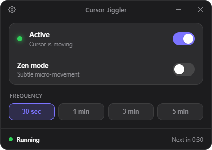

#  Cursor Jiggler

A tiny, pretty, cross‑platform mouse jiggler. It keeps your computer awake and your status active by nudging the cursor — but only when you're **idle**, so it never gets in the way while you're actually working.

  

## Features

- **Idle‑aware** — only moves the cursor after N seconds of no activity; any input resets the timer.
- **Zen mode** — a 1‑pixel nudge‑and‑return that's practically invisible.
- **Keeps the PC awake** while active (no sleep / screen‑off).
- **System tray** — status in the menu, a green dot on the icon when active, single/double‑click to open.
- **Autostart** at login, optionally **start minimized** to the tray.
- **Auto‑updates** — checks GitHub Releases and updates itself.
- **12 languages**, automatic from your system locale, with light/dark theme.

## Tech stack

- [Tauri 2](https://v2.tauri.app/) (Rust) + [Svelte 5](https://svelte.dev/) + Vite
- Cursor control via [`enigo`](https://crates.io/crates/enigo)

## License

MIT © [drxid](https://drxid.ru/)
